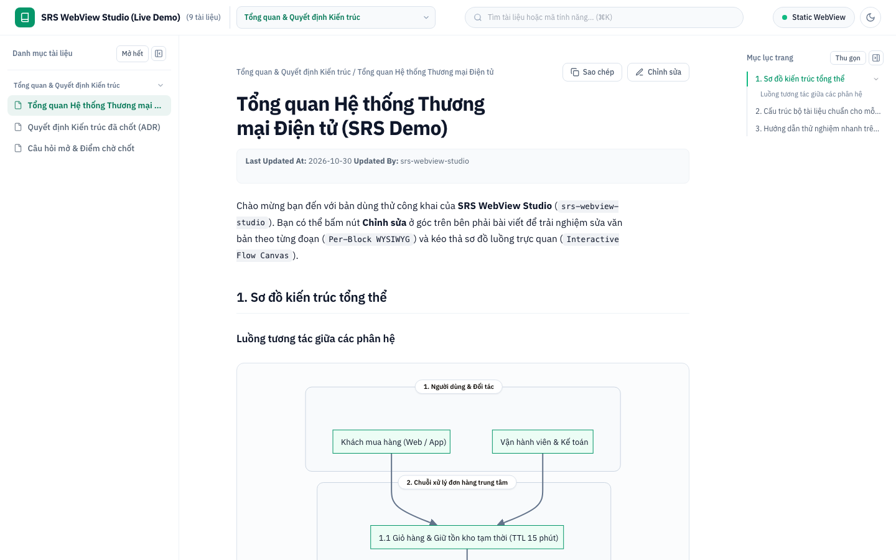
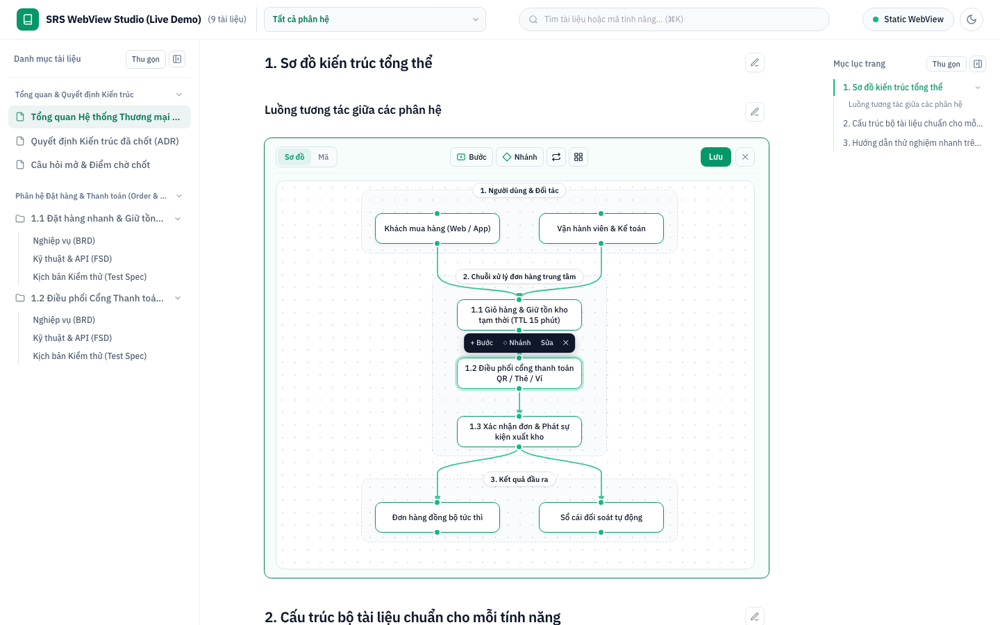
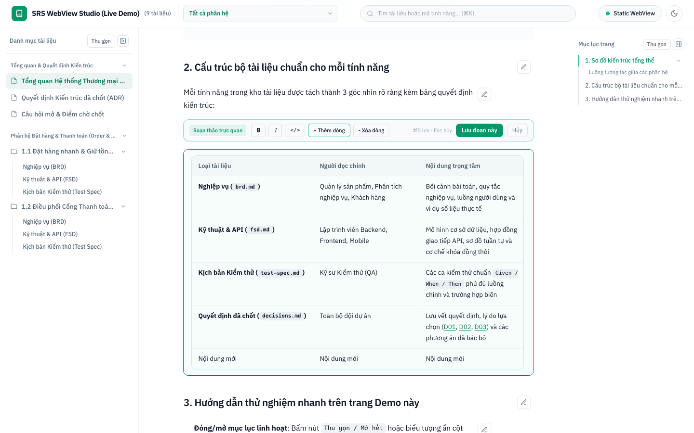
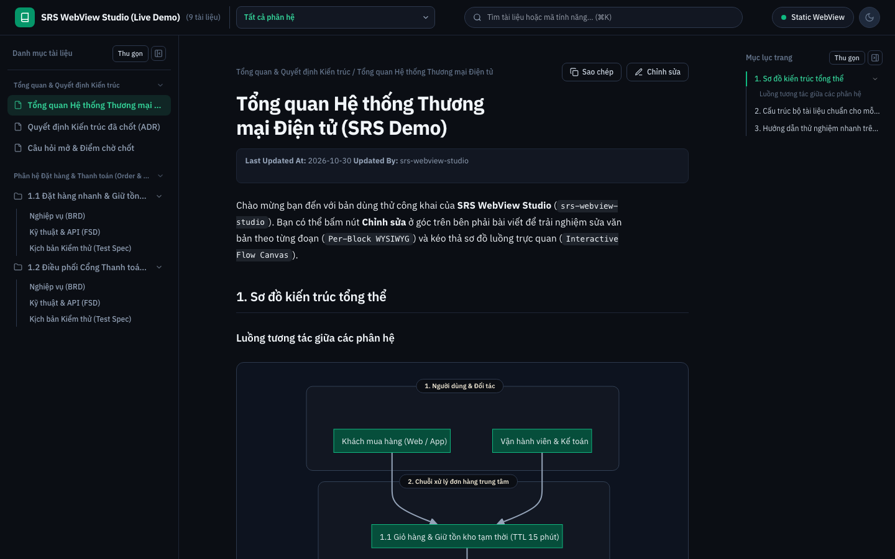
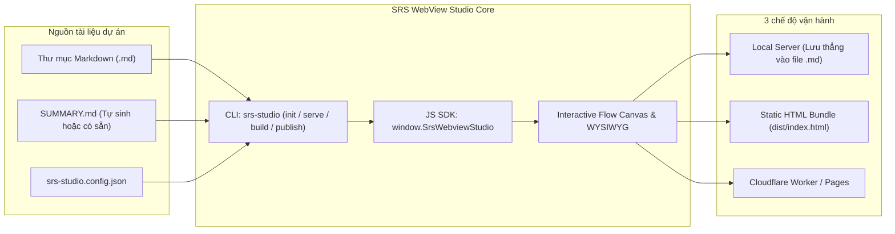

# SRS WebView Studio (`srs-webview-studio`)

> - **Live Demo (Public on Cloudflare)**: [https://srs-webview-studio-demo.phamhung-plane-ai.workers.dev](https://srs-webview-studio-demo.phamhung-plane-ai.workers.dev)
> - **Video Giới thiệu Sản phẩm (Full HD MP4)**: [Xem hoặc tải video MP4 (1440×900)](https://pub-dd118e9f58254711a5ec2f75e6bf0530.r2.dev/test-videos/srs-webview-studio-product-demo.mp4) · [File MP4 trong kho Git](./assets/srs-webview-studio-demo.mp4)

Bộ thư viện và công cụ dòng lệnh mã nguồn mở giúp chuyển đổi thư mục tài liệu Markdown (`BRD`, `FSD`, `Test Spec`, `Decisions`, `Open Questions`) sang giao diện WebView trực quan. Công cụ hỗ trợ chỉnh sửa văn bản theo từng đoạn (`Per-Block WYSIWYG`) và kéo thả sơ đồ luồng hai chiều (`Interactive Flow Canvas`).

## Video Giới thiệu & Trải nghiệm Nhanh

[](https://pub-dd118e9f58254711a5ec2f75e6bf0530.r2.dev/test-videos/srs-webview-studio-product-demo.mp4)

| Giao diện Đọc & Cây Danh mục Đa cấp | Kéo thả Sơ đồ Luồng (`Interactive Flow Canvas`) |
|---|---|
|  |  |
| **Soạn thảo Văn bản & Bảng biểu (`Per-Block WYSIWYG`)** | **Giao diện Tối (`Dark Mode`) Đồng bộ Sơ đồ** |
|  |  |

## 1. Kiến trúc tổng thể



## 2. Các tính năng đóng gói sẵn

- **Tự động lập cây mục lục**: Đọc file `SUMMARY.md` hoặc tự quét toàn bộ thư mục `.md` nếu dự án chưa có mục lục.
- **Mở rộng và thu gọn linh hoạt**: Hỗ trợ đóng/mở từng nhóm phân hệ, từng thư mục tính năng, từng nhánh mục lục trang (`H2 -> H3`) hoặc ẩn/hiện toàn bộ cột bên trái và cột bên phải.
- **Sửa văn bản trực quan theo đoạn**: Bấm biểu tượng bút chì ở góc phải để sửa ngay đoạn văn, tiêu đề hoặc bảng biểu.
- **Sửa sơ đồ kéo thả trực quan**: Kéo khối trên mặt phẳng lưới, bấm chọn khối/mũi tên để đổi chữ ngay trên thẻ nổi, kéo chấm xanh để nối mũi tên mới.
- **Đồng bộ hai chiều về Markdown**: Mọi thao tác sửa giao diện đều chuyển ngược về cú pháp Markdown và khối mã Mermaid chuẩn.

## 3. Cách dùng qua công cụ dòng lệnh (`srs-studio`)

```bash
# 1. Khởi tạo cấu hình và tự sinh SUMMARY.md cho dự án mới
srs-studio init ./docs --title "Tài liệu Dự Án" --domain "*"

# 2. Chạy máy chủ WebView tại máy cá nhân (lưu trực tiếp vào file .md trên ổ đĩa)
srs-studio serve ./docs --port 4321 --title "Tài liệu Dự Án"

# 3. Đóng gói thành gói HTML tĩnh độc lập để nhúng hoặc đưa lên Cloudflare / GitHub Pages / Vercel
srs-studio build ./docs --out-dir ./dist-webview --title "Tài liệu Dự Án"

# 4. Xuất bản lên đám mây Cloudflare Worker + R2
srs-studio publish ./docs --title "Tài liệu Dự Án" --no-auth

# 5. Kéo các trang đã sửa từ đám mây về lại thư mục dự án
srs-studio pull ./docs
```

## 4. Cách nhúng bằng JavaScript SDK (`srs-webview-studio`)

Bạn có thể nhúng trực tiếp trình hiển thị vào ứng dụng React, Next.js, Vue hoặc Electron:

```javascript
import { mountSrsWebviewStudio } from "srs-webview-studio";

mountSrsWebviewStudio("#srs-container", {
  title: "Tài liệu Dự Án Mới",
  authRequired: false,
  apiBaseUrl: "http://127.0.0.1:4321",
  defaultDocPath: "_index.md",
  onSaveDoc: async ({ path, content }) => {
    await fetch("/api/custom-save", {
      method: "POST",
      body: JSON.stringify({ path, content })
    });
  }
});
```

Khi chạy trực tiếp trên trình duyệt, đối tượng toàn cục `window.SrsWebviewStudio` cung cấp các hàm điều khiển:

- **Cấu hình thương hiệu**: Gọi `window.SrsWebviewStudio.configure({ title, allowedDomain, authRequired })`.
- **Chuyển trang tài liệu**: Gọi `window.SrsWebviewStudio.openDoc("duong-dan/file.md")`.
- **Lấy nội dung Markdown**: Gọi `window.SrsWebviewStudio.getMarkdown()`.
- **Bật hoặc tắt chế độ sửa**: Gọi `window.SrsWebviewStudio.toggleEditMode()`.
