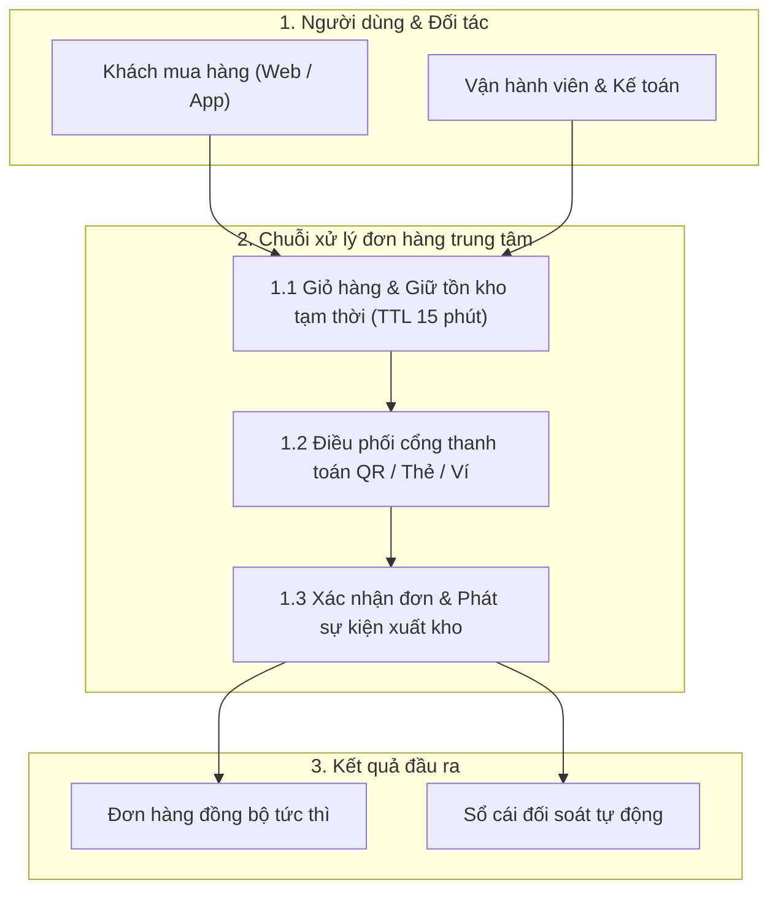

> **Last Updated At:** 2026-10-30 **Updated By:** srs-webview-studio

# Tổng quan Hệ thống Thương mại Điện tử (SRS Demo)

Chào mừng bạn đến với bản dùng thử công khai của **SRS WebView Studio** (`srs-webview-studio`). Bạn có thể bấm nút **Chỉnh sửa** ở góc trên bên phải bài viết để trải nghiệm sửa văn bản theo từng đoạn (`Per-Block WYSIWYG`) và kéo thả sơ đồ luồng trực quan (`Interactive Flow Canvas`).

## 1. Sơ đồ kiến trúc tổng thể

### Luồng tương tác giữa các phân hệ

## 2. Cấu trúc bộ tài liệu chuẩn cho mỗi tính năng

Mỗi tính năng trong kho tài liệu được tách thành 3 góc nhìn rõ ràng kèm bảng quyết định kiến trúc:

| Loại tài liệu | Người đọc chính | Nội dung trọng tâm |
|---|---|---|
| **Nghiệp vụ (`brd.md`)** | Quản lý sản phẩm, Phân tích nghiệp vụ, Khách hàng | Bối cảnh bài toán, quy tắc nghiệp vụ, luồng người dùng và ví dụ số liệu thực tế |
| **Kỹ thuật & API (`fsd.md`)** | Lập trình viên Backend, Frontend, Mobile | Mô hình cơ sở dữ liệu, hợp đồng giao tiếp API, sơ đồ tuần tự và cơ chế khóa đồng thời |
| **Kịch bản Kiểm thử (`test-spec.md`)** | Kỹ sư Kiểm thử (QA) | Các ca kiểm thử chuẩn `Given / When / Then` phủ đủ luồng chính và trường hợp biên |
| **Quyết định đã chốt (`decisions.md`)** | Toàn bộ đội dự án | Lưu vết quyết định, lý do lựa chọn ([D01](decisions.md), [D02](decisions.md), [D03](decisions.md)) và các phương án đã bác bỏ |

## 3. Hướng dẫn thử nghiệm nhanh trên trang Demo này

1. **Đóng/mở mục lục linh hoạt**: Bấm nút `Thu gọn / Mở hết` hoặc biểu tượng ẩn cột trên thanh **Danh mục tài liệu** (bên trái) và **Mục lục trang** (bên phải).
2. **Nhảy thẳng tới dòng quyết định**: Bấm vào mã quyết định như [D01](decisions.md) hoặc [D02](decisions.md) để tự động mở bảng quyết định, cuộn tới đúng dòng đó và tô sáng.
3. **Sửa trực quan từng đoạn và kéo thả sơ đồ**: Bấm nút **Chỉnh sửa**, sau đó bấm biểu tượng bút chì ở góc phải của bất kỳ đoạn văn, bảng biểu hoặc sơ đồ nào để chỉnh sửa trực tiếp.
