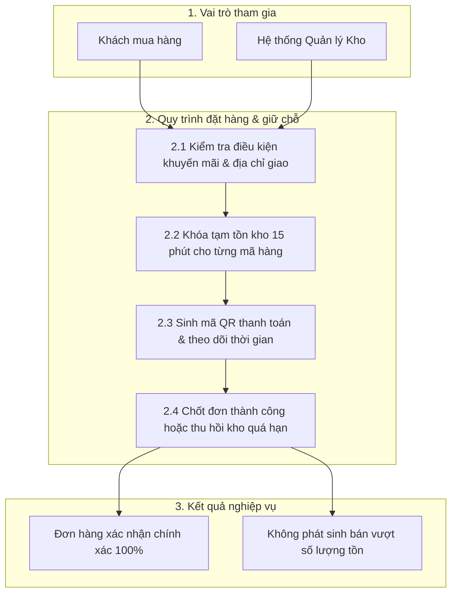

> **Last Updated At:** 2026-10-30 **Updated By:** srs-webview-studio

# 1.1 Đặt hàng nhanh & Giữ tồn kho thời gian thực - BRD

## 1. Bối cảnh & Mục tiêu

### 1.1 Vấn đề nghiệp vụ

Trong các khung giờ cao điểm hoặc chiến dịch khuyến mãi lớn, nhiều khách hàng cùng bấm đặt mua những sản phẩm cuối cùng trong kho. Nếu hệ thống không giữ chỗ tồn kho ngay tại thời điểm tạo đơn mà chờ tới khi cổng thanh toán báo về mới trừ kho, khách hàng đã chuyển tiền có nguy cơ bị hủy đơn do hết hàng.

### 1.2 Giải pháp nghiệp vụ

Áp dụng cơ chế **Giữ tồn kho tạm thời 15 phút** ngay khi khách hàng bấm nút *Đặt hàng* theo quyết định [D01](../../decisions.md) và chống tạo trùng đơn bằng khóa định danh lượt bấm theo [D02](../../decisions.md).

## 2. Sơ đồ luồng nghiệp vụ

### 2.1 Sơ đồ tổng quan luồng đặt hàng

### 2.2 Quy tắc tính toán & giới hạn

| Hạng mục | Quy tắc áp dụng | Ví dụ minh họa |
|---|---|---|
| **Thời gian giữ hàng tối đa** | 15 phút kể từ giây đơn hàng chuyển sang trạng thái *Chờ thanh toán* | Đơn tạo lúc `10:00:00` sẽ hết hạn giữ chỗ lúc `10:15:00` |
| **Số lượng tối đa mỗi đơn** | Tối đa 20 dòng sản phẩm khác nhau trong một đơn hàng | Giỏ hàng có 5 mẫu áo (mỗi mẫu 2 chiếc) được tính là 5 dòng sản phẩm |
| **Tự động hoàn tồn kho** | Ngay khi khách bấm *Hủy đơn* hoặc quá 15 phút chưa thanh toán, số lượng giữ tạm được cộng trả lại kho khả dụng | Kho còn 10 chiếc, khách giữ 2 chiếc (còn 8); sau 15 phút không thanh toán kho tự về lại 10 chiếc |
