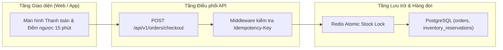
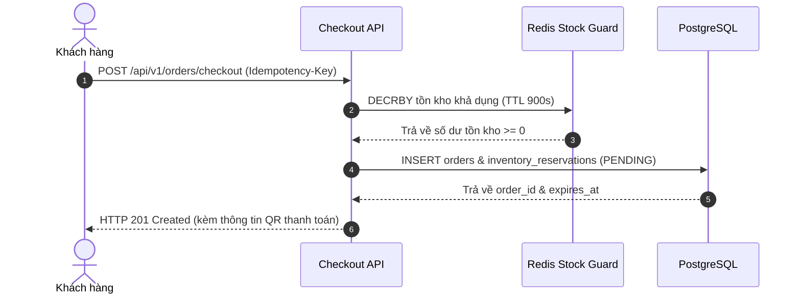

> **Last Updated At:** 2026-10-30 **Updated By:** srs-webview-studio

# 1.1 Đặt hàng nhanh & Giữ tồn kho thời gian thực - FSD

## 1. Kiến trúc kỹ thuật & Luồng xử lý

### 1.1 Sơ đồ kiến trúc thành phần

### 1.2 Sơ đồ tuần tự xử lý đặt hàng

## 2. Đặc tả Hợp đồng API

| Phương thức & Đường dẫn | Đầu vào chính | Phản hồi thành công | Mã lỗi nghiệp vụ |
|---|---|---|---|
| `POST /api/v1/orders/checkout` | Header `Idempotency-Key`, mảng `items[{sku, qty}]`, `shipping_address_id` | `201 Created` kèm `order_id`, `status = "PENDING_PAYMENT"`, `expires_at` | `409 OUT_OF_STOCK`, `422 INVALID_VOUCHER` |
| `POST /api/v1/orders/{id}/cancel` | `reason` | `200 OK` kèm trạng thái `CANCELLED` và hoàn lại tồn kho tức thì | `400 ORDER_ALREADY_PAID` |
