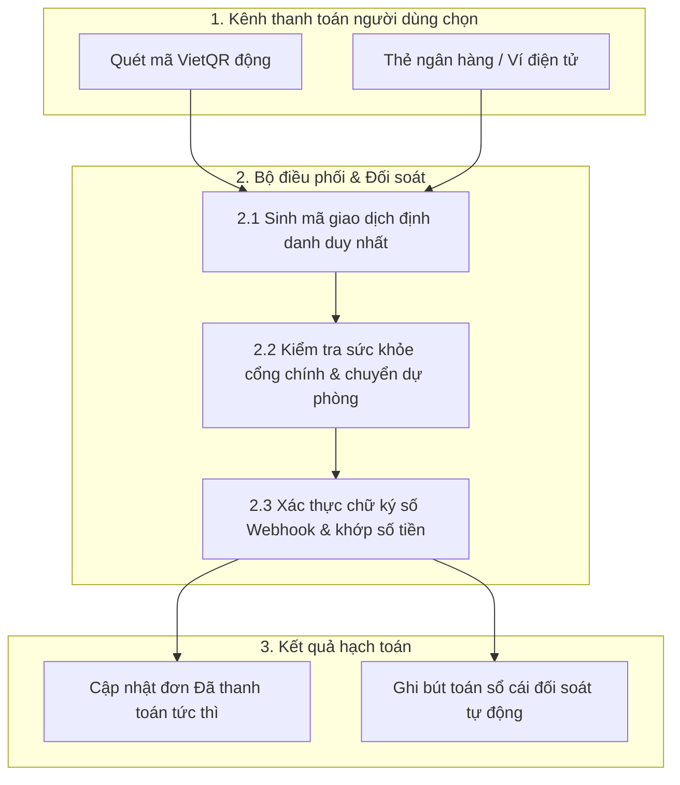

> **Last Updated At:** 2026-10-30 **Updated By:** srs-webview-studio

# 1.2 Điều phối Cổng Thanh toán Đa kênh & Đối soát - BRD

## 1. Bối cảnh & Mục tiêu

Hệ thống cần kết nối nhiều kênh thanh toán (mã VietQR động, thẻ nội địa NAPAS, thẻ quốc tế và ví điện tử) với khả năng tự động chuyển kênh dự phòng khi một đối tác ngân hàng bảo trì theo quyết định [D03](../../decisions.md).

## 2. Sơ đồ luồng điều phối thanh toán

