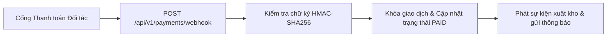

> **Last Updated At:** 2026-10-30 **Updated By:** srs-webview-studio

# 1.2 Điều phối Cổng Thanh toán Đa kênh & Đối soát - FSD

## 1. Sơ đồ kiến trúc xử lý Webhook Thanh toán

## 2. Quy tắc bảo mật & chống ghi đè

1. **Xác thực chữ ký số (`HMAC-SHA256`)**: Mọi thông báo kết quả thanh toán từ đối tác bắt buộc phải khớp chữ ký mật mã và nằm trong cửa sổ thời gian 5 phút.
2. **Xử lý bất biến một chiều**: Khi đơn hàng đã chuyển sang trạng thái `PAID`, các thông báo trùng lặp đến sau chỉ trả về `200 OK` mà không sinh thêm bút toán mới.
